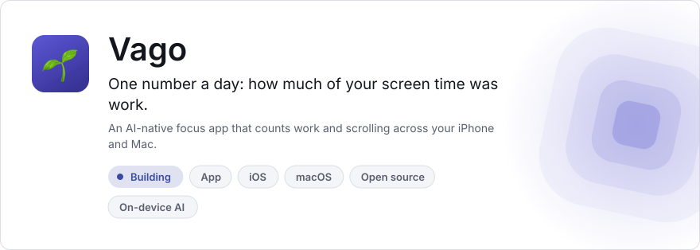
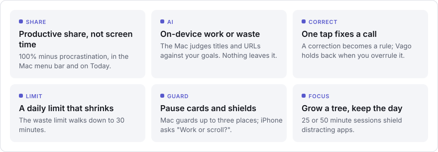
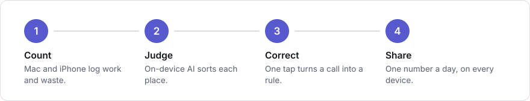

<!-- Pictures: docs/readme/spec.json, drawn by readme-kit. Do not edit the SVGs by hand. -->
<picture><source media="(prefers-color-scheme: dark)" srcset="docs/readme/hero-dark.svg"></picture>

**Vago stops the scroll by showing the productive share: 100% minus the share of waste.**
It is built for one person who loses time to scrolling. The apps run on iPhone and Mac; the iPhone
app is on internal TestFlight and is not on sale.

[Docs: product rules](docs/PRODUCT.md) · [Mac app](docs/MAC.md) · [AI tools](docs/AI.md) · [Releases](docs/RELEASE.md)

## What it does

<picture><source media="(prefers-color-scheme: dark)" srcset="docs/readme/highlights-dark.svg"></picture>

- **Menu-bar share.** `😄 92%` on the Mac. It reads "—" before 15 active minutes.
- **iPhone Today.** An hour-by-hour strip, widgets and a Live Activity.
- **Mac desktop widget.** One strip per device.
- **Smart buckets.** Productive, neutral, procrastination, ambiguous. Instagram can be work.
- **Silent by day.** Vago never asks during the day; an unsure place counts as neutral.
- **Day window (Mac).** Lists Vago's calls with the AI's reason. The popover's **Wrong?** and a work switch correct too.
- **Guard notice (Mac).** Says when 60 seconds of procrastination follow work.
- **Intent check (iPhone).** Ambiguous apps ask "Work or scroll?" before they open.
- **Focus trees.** 🌱 → 🌳 when a session ends; a distraction wilts it 🥀.
- **Move breaks (Mac).** After 90 minutes without a break: one 2-minute desk exercise with exact reps. It waits out focus and calls, and asks at most twice.
- **Ask it.** Siri and Shortcuts on iPhone ("How focused am I in Vago"); a read-only MCP server on the Mac so Claude Code or Codex can answer "how focused was I today" ([docs/AI.md](docs/AI.md)).

## How it works

<picture><source media="(prefers-color-scheme: dark)" srcset="docs/readme/steps-dark.svg"></picture>

How the parts fit together: [docs/ARCHITECTURE.md](docs/ARCHITECTURE.md).

## Quick start

```bash
git clone https://github.com/zaitsew/vago && cd vago
git config core.hooksPath .githooks   # ./check.sh before every push
./check.sh                            # VagoKit tests + both app builds
scripts/install-mac.sh                # Mac menu-bar app in /Applications
scripts/install-mcp.sh                # optional: vago-mcp for Claude Code or Codex
```

- **iPhone:** run `xcodegen generate`, open `Vago.xcodeproj` and run the Vago scheme on your phone ([docs/RELEASE.md](docs/RELEASE.md)). A build also goes to internal TestFlight.
- **First run:** the Mac app asks for Accessibility and Automation; the iPhone app asks for Screen Time.

## Docs

| Document | What is in it |
|---|---|
| [docs/PRODUCT.md](docs/PRODUCT.md) | The product rules |
| [docs/MAC.md](docs/MAC.md) | The Mac app |
| [docs/ARCHITECTURE.md](docs/ARCHITECTURE.md) | How it works |
| [docs/AI.md](docs/AI.md) | Siri, Shortcuts and the read-only MCP server |
| [docs/RELEASE.md](docs/RELEASE.md) | iPhone build and TestFlight |

## License

Apache 2.0.

<sub>Built by <a href="https://github.com/zaitsew">zaitsew</a> with a fleet of AI agents.</sub>

<!-- teyla:reviewed 2026-11-13 -->
